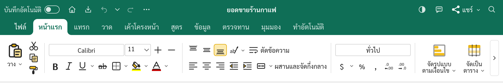
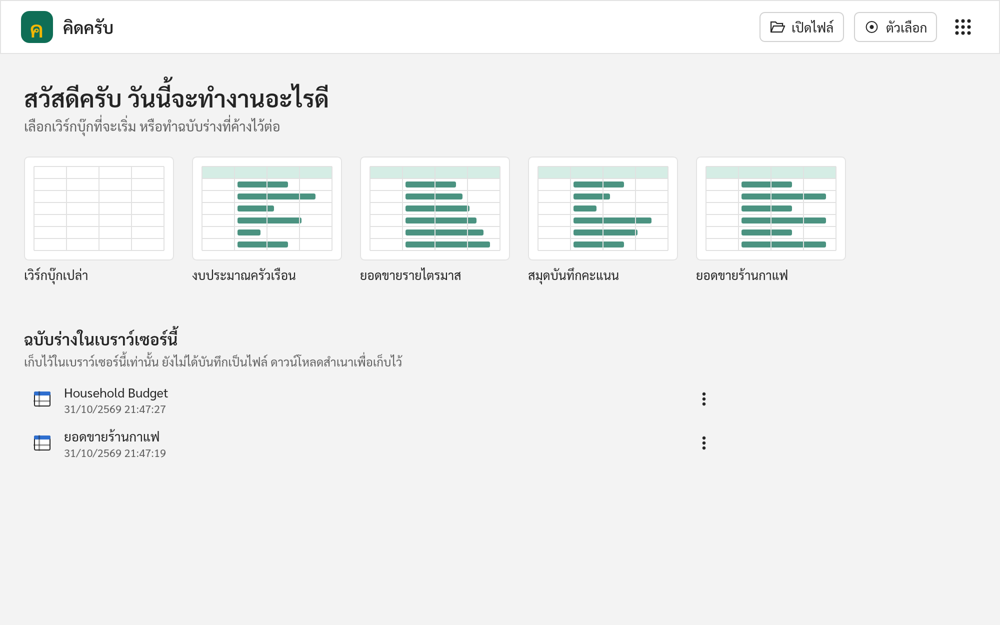
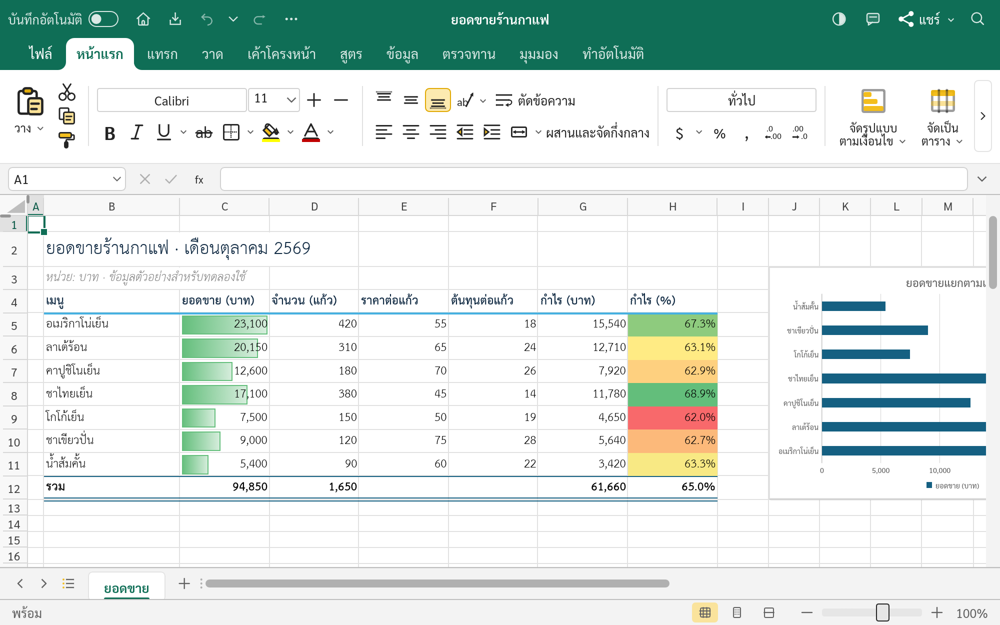
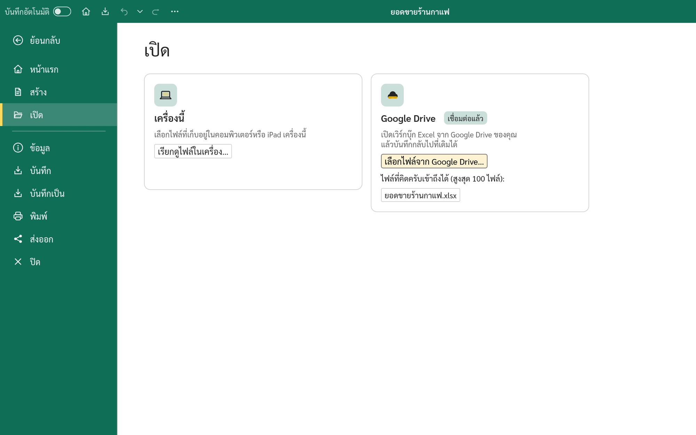
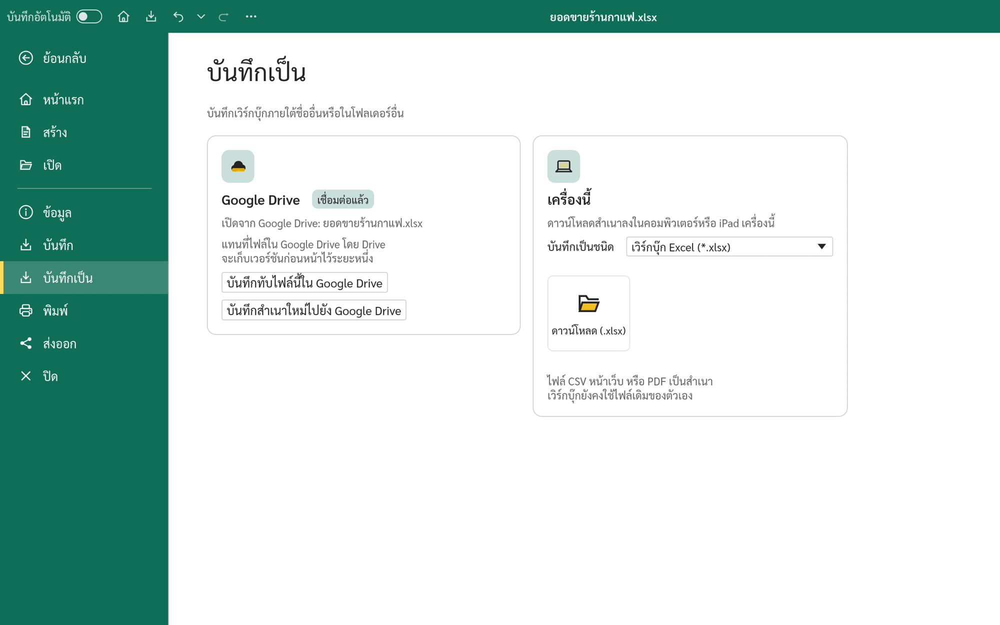
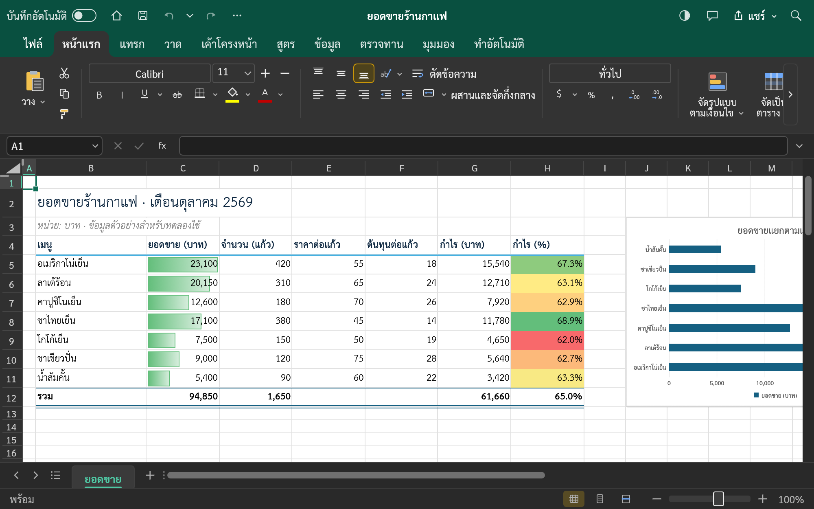
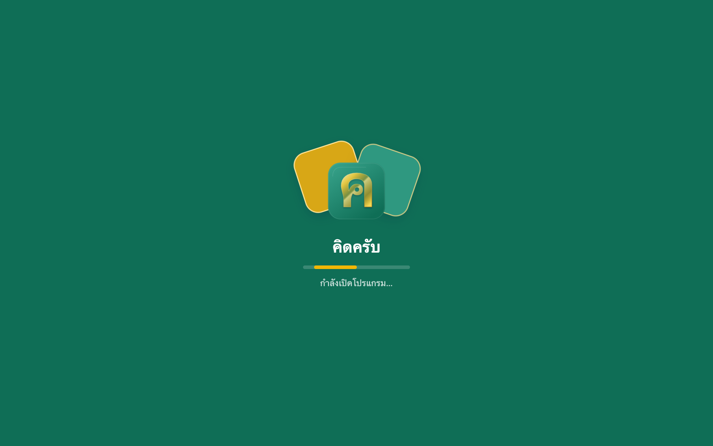

# คิดครับ · KhitKrub

**คิดครับ (KhitKrub)** คือโปรแกรมตารางคำนวณภาษาไทยและภาษาอังกฤษ ใช้งานฟรีบนเว็บ เป็นส่วนหนึ่งของ **KrubOffice**
ร่วมกับ [เขียนครับ (KhianKrub)](https://github.com/chanonss/khiankrub-web) ซึ่งเป็นโปรแกรมพิมพ์เอกสาร
และ [พูดครับ (PhutKrub)](https://github.com/chanonss/phutkrub-web) ซึ่งเป็นโปรแกรมทำงานนำเสนอ

KhitKrub is a free spreadsheet app for Thai and English that runs in the browser. It is part of **KrubOffice**, beside
[KhianKrub](https://github.com/chanonss/khiankrub-web), the word processor, and [PhutKrub](https://github.com/chanonss/phutkrub-web), the presentation app.

This is Chanon Sarasuk's fork of [GridCraft](https://github.com/storytold/gridcraft) by the ArtCraft team (MIT or Apache-2.0, at your option),
kept for a Thai-speaking audience. KhitKrub is not an ArtCraft product, and it is not affiliated with Microsoft.

## สถานะ · Status

เปิดใช้งานแล้วที่ **<https://khitkrub.app>** (รุ่น 0.2.0) · Live at **<https://khitkrub.app>** (version 0.2.0).

  

- **เมนูภาษาไทย · Thai interface**, written from the plain meaning of the English labels (clean room: no Microsoft localisation is consulted). The web app opens in Thai and remembers a switch to English.
- **ฟอนต์ไทย · Thai fonts**: Sarabun for the interface, TH Sarabun New draws Thai letters in cells (SIL OFL 1.1 and GPL with the font exception; the files are loaded from the site, never committed). New workbooks keep GridCraft's default font (Calibri 11 pt).
- **ธีม · Theme**: a teal band with gold highlights and a white active tab, as in the app's icon (a glass gold ค on teal), in light and dark.
- **หน้าเริ่มต้นและฉบับร่างในอุปกรณ์นี้ · Start screen and drafts on this device**: new workbooks and samples open in new tabs, and a workbook not yet saved as a file or to Google Drive is kept as a draft in the browser (not uploaded): the title bar says "(draft) — Saved on this device", the tab closes without asking, and the start screen lists it as "Name (draft)".
- **ไอคอนชุดใหม่ · New icons**: the shared KrubOffice icon set (also in KhianKrub and PhutKrub) and KhianKrub's larger, centred ribbon on every tab. Icons inserted into a workbook keep their original artwork.
- **Google Drive (ทดลอง · experimental).** เชื่อมต่อ Google Drive ได้ในคลิกเดียว เปิดไฟล์ `.xlsx` จาก Drive แล้วกด**บันทึก** (Ctrl+S) เพื่อบันทึกกลับไปที่ไฟล์เดิม หรือบันทึกเป็นสำเนาใหม่ จากการ์ด **เครื่องนี้ / Google Drive** ในหน้าเปิดและหน้าบันทึกเป็น · Connect Google Drive in one click, open an `.xlsx` from Drive, and **Save** (Ctrl+S) puts it back over the same file; or save a new copy. The Open and Save As pages show two places, *This device* and *Google Drive*. KhitKrub asks only for the files you pick or it creates (`drive.file`), and stays signed in through `drive.khitkrub.app`. Shared with KhianKrub (the `krub-drive` crate). **Not on khitkrub.app yet**: it appears there once the connection service and Google settings for the site are switched on.
- Everything else is GridCraft: formulas and functions, charts, pivot tables, open and save `.xlsx`, and every button is also a command for the CLI and MCP.

## หน้าตาโปรแกรม · A look around

<table>
<tr>
<td width="50%" valign="top">
<b>หน้าเริ่มต้น · Start screen</b>
</td>
<td width="50%" valign="top">
<b>ตารางคำนวณ · A spreadsheet</b>
</td>
</tr>
<tr>
<td width="50%" valign="top">
<b>เปิดจาก Google Drive · Open from Google Drive</b>
</td>
<td width="50%" valign="top">
<b>บันทึกกลับไปที่ Drive · Save back to Drive</b>
</td>
</tr>
<tr>
<td width="50%" valign="top">
<b>ธีมมืด · Dark theme</b>
</td>
<td width="50%" valign="top">
<b>หน้ารอเปิดโปรแกรม · Loading screen</b>
</td>
</tr>
</table>

## ความเป็นส่วนตัว · Privacy

ตารางคำนวณประมวลผลในเบราว์เซอร์ ฉบับร่างเก็บในเบราว์เซอร์นี้เท่านั้น Google Drive เชื่อมต่อเมื่อคุณกดเชื่อมต่อเท่านั้น และเข้าถึงได้เฉพาะไฟล์ที่คุณเลือกหรือที่คิดครับสร้าง
เพื่อให้เชื่อมต่อค้างไว้ระหว่างการเข้าชม บริการที่ drive.khitkrub.app (บริการเดียวกับ drive.khiankrub.app ของเขียนครับ) เก็บโทเค็นของ Google แบบเข้ารหัส และยกเลิกการเชื่อมต่อได้ทุกเมื่อ

Workbooks are processed in the browser; drafts stay in this browser. Google Drive connects only when you choose to, and
KhitKrub sees only the files you pick or it creates (`drive.file`). To stay connected between visits, the service at
drive.khitkrub.app (the same service as KhianKrub's drive.khiankrub.app) stores Google tokens encrypted; you can
disconnect at any time. Network use: Google sign-in (`accounts.google.com`), Google Picker (`apis.google.com`), the Drive
API (`www.googleapis.com`) and drive.khitkrub.app, all only after you connect. Embedded in another page (`?host=parent`),
KhitKrub has no Drive: the page around it owns the files.

## License and credits

KhitKrub keeps GridCraft's licences: [MIT](LICENSE-MIT) or [Apache-2.0](LICENSE-APACHE), at your option. Copyright (c) 2026 ArtCraft Team and the
GridCraft contributors. Required notices are in [NOTICE](NOTICE); every bundled asset is listed in [ATTRIBUTION.md](ATTRIBUTION.md).
What this fork changes is in [FORK-CHANGES.md](FORK-CHANGES.md). The ArtCraft name and logos are not part of this version.

### Desktop recovery

KhitKrub checkpoints committed changes in unsaved workbooks about every 30 seconds, in a private recovery folder on the device. After an interrupted session, File › Recover lists available copies. Restoring opens an unsaved copy; it does not change the original file. Saving or deliberately closing a workbook removes its checkpoint, and discarding a recovery copy requires confirmation. Recovery files are limited to 256 MiB. A cell or object currently being edited is included after the edit is committed.

Workbooks opened with a password are not written to plaintext recovery files. After saving an unencrypted copy, subsequent edits to that copy can be recovered. Recovery copies are opened with the same active-content restrictions as files from outside the app.
