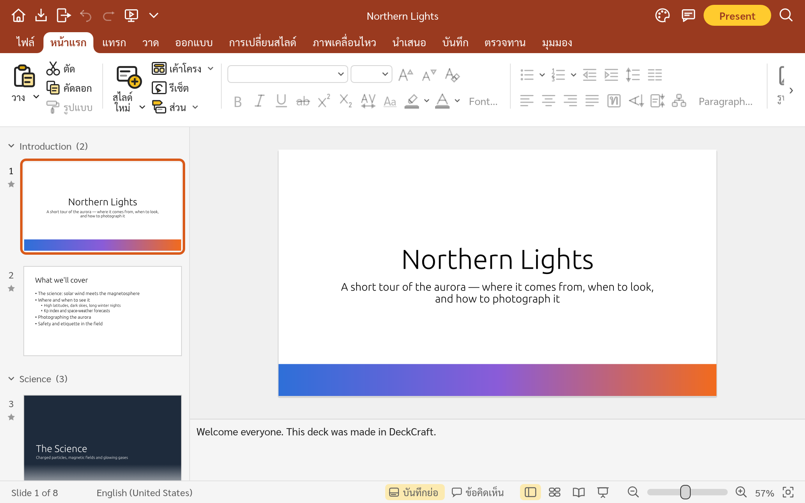
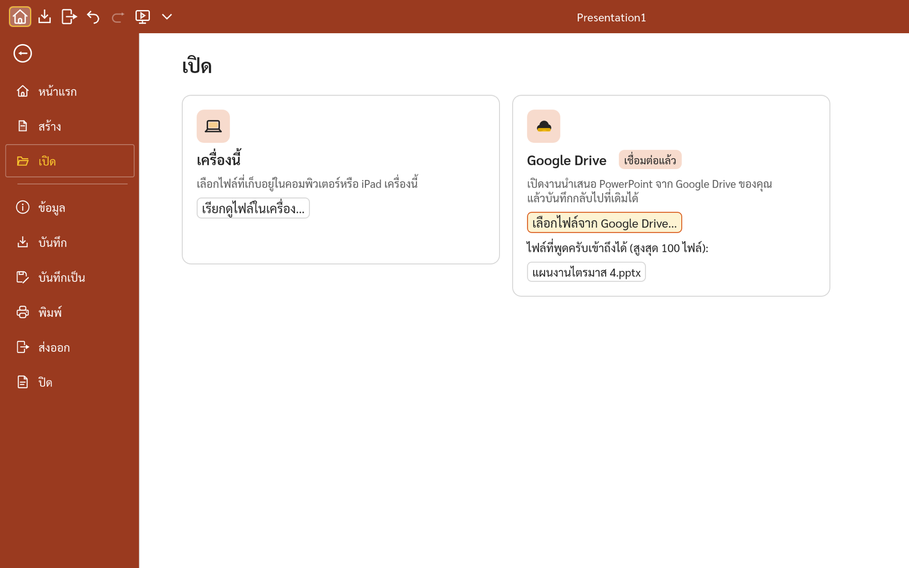
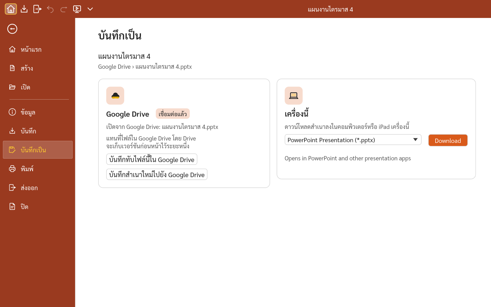

# พูดครับ · PhutKrub

**พูดครับ (PhutKrub)** คือโปรแกรมทำงานนำเสนอภาษาไทยและภาษาอังกฤษ ใช้งานฟรีบนเว็บ เป็นส่วนหนึ่งของ **KrubOffice**
ร่วมกับ [เขียนครับ (KhianKrub)](https://github.com/chanonss/khiankrub) ซึ่งเป็นโปรแกรมพิมพ์เอกสาร

PhutKrub is a free presentation app for Thai and English that runs in the browser. It is part of **KrubOffice**,
beside [KhianKrub](https://github.com/chanonss/khiankrub), the word processor.

This is Chanon Sarasuk's fork of [DeckCraft](https://github.com/storytold/deckcraft) by the ArtCraft team (Apache-2.0 / MIT),
kept for a Thai-speaking audience. PhutKrub is not an ArtCraft product, and it is not affiliated with Microsoft.

## สถานะ · Status

เปิดใช้งานแล้วที่ **<https://phutkrub.app>** (รุ่นทดลอง 0.4.0) · Live at **<https://phutkrub.app>** (early release 0.4.0).

<p align="center">
  
</p>

- **หน้าเริ่มต้นและฉบับร่าง · Start screen and drafts.** Opening PhutKrub shows a start screen like KhianKrub's: themes, starter decks, the drafts kept in this browser (about two seconds after you stop typing; nothing leaves the device), Open file, Options and an app switcher. Each choice opens in a new tab (`?theme=`, `?template=`, `?draft=`, `?new=blank`).
- **เมนูภาษาไทย · Thai interface.** The web app opens in Thai on a first visit, whatever the browser's language, and
  remembers a switch to English. Ribbon tabs, buttons, menus, the File pages and the command search have Thai text,
  written from the plain meaning of the English labels (clean room: no Microsoft localisation was consulted).
  Anything not yet translated shows in English.
- **ฟอนต์ไทย · Thai fonts.** The interface uses Sarabun (SIL OFL 1.1); new slides use TH Sarabun New. The font files are
  loaded from the site and are never committed to this repository (`packaging/web/prepare-fonts.sh`).
- **ธีม · Theme.** KhianKrub's design in PhutKrub's colour: a coral band (the icon's colour) with a white active tab joined to a flat ribbon and gold highlights; the app icon is a gold พ on coral.
- **กระจายแบบไทย · Thai Distribution.** A ท button after Justify on the Home tab, also in the Paragraph dialog and the Format menu: it fills each line by spreading space over spaces and the gaps between Thai letters (vowels and tone marks stay attached, English words and a paragraph's last line aren't stretched). Saved in `.pptx` as `thaiDist`; undoable.
- **ไอคอนชุดใหม่ · New icons.** The shared KrubOffice icon set (also in KhianKrub and KhitKrub), KhianKrub's larger, centred ribbon, and a glass gold พ logo on the loading and start screens, with KhianKrub's loading animation.
- **Google Drive (ทดลอง · experimental).** เชื่อมต่อ Google Drive ได้ในคลิกเดียว เปิดไฟล์ `.pptx` จาก Drive แล้วกด**บันทึก** (Ctrl+S) เพื่อบันทึกกลับไปที่ไฟล์เดิม หรือบันทึกเป็นสำเนาใหม่ จากการ์ด **เครื่องนี้ / Google Drive** ในหน้าเปิดและหน้าบันทึก · Connect Google Drive in one click, open a `.pptx` from Drive, and **Save** (Ctrl+S) puts it back over the same file; or save a new copy. The Open and Save pages show two places, *This device* and *Google Drive*. PhutKrub asks only for the files you pick or it creates (`drive.file`), and stays signed in through `drive.phutkrub.app`. Shared with KhianKrub (the `krub-drive` crate). **Not on phutkrub.app yet**: it appears there once the connection service and Google settings for the site are switched on.

<p align="center">
  
  
</p>

- Everything else is DeckCraft: themes and layouts, shapes, pictures, tables, charts, transitions and animations,
  open and save `.pptx`, present full screen, and every button is also a command for the CLI and MCP.

## สร้างและทดลองใช้ · Build and try

```sh
sh packaging/web/prepare-fonts.sh        # Thai font files (needs KhianKrub's prepared bundle)
cd apps/deckcraft-web && trunk serve     # http://127.0.0.1:8768
```

`?webgl` forces WebGL2, `?sample` opens DeckCraft's sample deck, `?show` starts the slide show.

## ความเป็นส่วนตัว · Privacy

งานนำเสนอประมวลผลในเบราว์เซอร์ ฉบับร่างเก็บในเบราว์เซอร์นี้เท่านั้น Google Drive เชื่อมต่อเมื่อคุณกดเชื่อมต่อเท่านั้น และเข้าถึงได้เฉพาะไฟล์ที่คุณเลือกหรือที่พูดครับสร้าง
เพื่อให้เชื่อมต่อค้างไว้ระหว่างการเข้าชม บริการที่ drive.phutkrub.app (บริการเดียวกับ drive.khiankrub.app ของเขียนครับ) เก็บโทเค็นของ Google แบบเข้ารหัส และยกเลิกการเชื่อมต่อได้ทุกเมื่อ

Presentations are processed in the browser; drafts stay in this browser. Google Drive connects only when you choose to, and
PhutKrub sees only the files you pick or it creates (`drive.file`). To stay connected between visits, the service at
drive.phutkrub.app (the same service as KhianKrub's drive.khiankrub.app) stores Google tokens encrypted; you can
disconnect at any time. Network use: Google sign-in (`accounts.google.com`), Google Picker (`apis.google.com`), the Drive
API (`www.googleapis.com`) and drive.phutkrub.app, all only after you connect.

## KrubOffice

PhutKrub is one of three apps in [KrubOffice](https://kruboffice.app/) (KhianKrub for documents, PhutKrub for presentations, KhitKrub for spreadsheets). The suite's README, with the apps' origins and screenshots, is in [chanonss/kruboffice-web](https://github.com/chanonss/kruboffice-web). Keep it and this README in step when the app changes.

## ที่มา · Credits

PhutKrub is built on [DeckCraft](https://github.com/storytold/deckcraft), an open-source, clean-room presentation app
written in Rust by the ArtCraft team and contributors. See [FORK-CHANGES.md](FORK-CHANGES.md) for what differs,
[ATTRIBUTION.md](ATTRIBUTION.md) for every asset, and `LICENSE-MIT` / `LICENSE-APACHE` for the licences.
The original project's own README and roadmap are in [ROADMAP.md](ROADMAP.md) and `docs/`.
